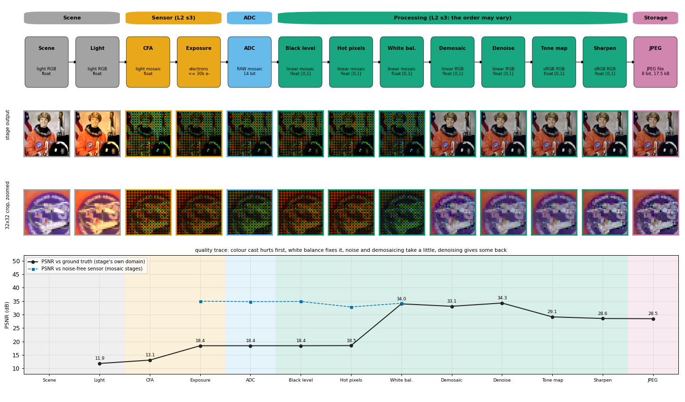

# Camera Pipeline and Post-processing (EE 5176 Computational Photography)

A small, readable toolkit that simulates a digital camera from photons to a JPEG file,
and implements the post-processing methods of lectures 2-5: sensor noise, colour filter
arrays and demosaicing, white balance, tone mapping, denoising, sharpening and JPEG
compression. Every intermediate stage can be inspected, measured against ground truth,
re-parameterised, switched off or re-ordered. Everything runs on CPU in NumPy / SciPy,
is tested, and is exposed through an interactive Streamlit app and Jupyter notebooks.



## Quick start

```bash
cd camera-pipeline
python -m pytest tests -q                   # every method checked against ground truth
streamlit run app/streamlit_app.py          # click any box of the pipeline to open that stage
~/anaconda3/bin/jupyter lab notebooks/      # guided walk-through (anaconda jupyter has ipywidgets)
```

```python
import isp
res = isp.simulate("astronaut", size=256)            # scene -> sensor -> ADC -> ISP -> JPEG
for r in res:
    print(r.name, r.meta["domain"], r.metrics.get("psnr"))
p = isp.default_pipeline(adc={"iso": 6400}, demosaic={"method": "bilinear"})
p.move("denoise", before="demosaic")                  # the processing order may vary (L2 s3)
res2 = isp.simulate("astronaut", pipeline=p)
```

## The pipeline

The default camera follows the camera pixel pipeline of lecture 2 (slide 3) and the noise
model of slide 34. Stage ids are also the app's page names.

| Box (L2 s3) | Stage | What happens | Data after the stage |
|---|---|---|---|
| Scene | `scene` | ground-truth linear RGB | linear RGB |
| | `illuminant` | light-source colour cast (3200 K tungsten by default) | linear RGB |
| Sensor | `cfa` | Bayer colour filter array sampling | mosaic |
| | `exposure` | photons x QE x t, shot noise, dark current, hot pixels, PRNU, full well | electrons |
| ADC | `adc` | read noise, ISO gain, black level, quantisation | RAW DN, 14 bit |
| Processing | `black_level` | black-level or dark-frame subtraction, normalisation | linear mosaic |
| | `hot_pixels` | hot-pixel removal | linear mosaic |
| | `white_balance` | gains from white patch / gray world / a neutral patch | linear mosaic |
| | `demosaic` | Freeman median-chroma (or bilinear, bicubic, Malvar, nearest) | linear RGB |
| | `denoise` | bilateral filter (or Gaussian, luma-chroma, NLM, median) | linear RGB |
| | `tonemap` | sRGB curve (or gamma, histogram equalisation, CLAHE, dodge and burn) | display RGB |
| | `sharpen` | unsharp masking, `S = x + lambda F(x)` | display RGB |
| Storage | `jpeg` | YCbCr, 4:2:0, 8x8 DCT, quantisation, Huffman coding | JPEG bytes |

Each stage is compared with the ground truth in its own data domain, so the quality
trace shows where quality is lost and won: the colour cast costs most, white balance
recovers it, demosaicing costs a little, denoising wins some back, JPEG at quality 85
costs almost nothing. The whole camera runs in about 0.1 s at 256 x 256, and moving a
late-stage parameter recomputes only the stages after it.

## Reading order (docs/)

| # | Document | What you learn | Module |
|---|---|---|---|
| 00 | [Camera pipeline](docs/00_camera_pipeline.md) | the stages, data domains, how quality is measured, running and reordering | `isp/pipeline.py` |
| - | [Conventions](docs/conventions.md) | data layout, meta keys, API contract, doc template | `isp/utils.py` |
| 01 | [Sensor and noise](docs/01_sensor_and_noise.md) | shot / dark / hot-pixel / FPN / read noise, SNR, dynamic range, ISO vs exposure, averaging | `isp/sensor.py` |
| 02 | [Colour sensing and demosaicing](docs/02_color_sensing_demosaicing.md) | CFAs, five demosaicing methods, moire, luma vs chroma, colour-sensing technologies | `isp/cfa.py`, `isp/demosaic.py` |
| 03 | [White balance](docs/03_white_balance.md) | chromaticity, CIE xy, colour temperature, manual / gray-world / white-patch AWB | `isp/whitebalance.py` |
| 04 | [Tone mapping](docs/04_tone_mapping.md) | gamma, histogram equalisation, CLAHE, local dodging and burning | `isp/tonemap.py` |
| 05 | [Denoising](docs/05_denoising.md) | Gaussian vs bilateral filtering, luma-chroma denoising, NLM, frame averaging | `isp/denoise.py` |
| 06 | [Sharpening](docs/06_sharpening.md) | Laplacian kernels, unsharp masking, halos, noise amplification | `isp/sharpen.py` |
| 07 | [Compression](docs/07_compression.md) | the JPEG codec stage by stage, rate-distortion, generation loss, EXIF and RAW | `isp/jpeg.py` |
| 08 | [Pipeline experiments](docs/08_pipeline_experiments.md) | switching stages off, changing their order, ISO vs exposure, ADC bit depth | `isp/pipeline.py` |

Each method document follows the same eight sections (overview, theory, algorithm,
implementation notes, experiments, try it, limitations, references) and cites the slide
pages it explains. All figures in `docs/figures/` are regenerated by
`scripts/make_figures_*.py`; no slide images are reproduced.

## Headline results

All numbers are measured by the figure scripts (see the docs for the setup).

* **Sensor (L2):** the SNR and dynamic-range formulas reproduce the slide examples
  (Retiga 4000R 20.85:1 and 3314:1, Aptina MT9P031 6.45:1 and 1504:1, slides 32-33);
  Monte Carlo SNR agrees with theory to within 2 %; averaging M frames improves noise by
  sqrt(M) (1.99x at M = 4, 3.81x at M = 16).
* **Demosaicing (L3):** mean PSNR over four photos: nearest 26.9 dB, bilinear 31.8,
  bicubic 32.0, Malvar 34.7, Freeman median-chroma 34.7; on the zone plate the median
  method cuts false colour from 0.245 (bilinear) to 0.140. Bilinear matches OpenCV to 1.5e-5.
* **White balance (L4):** under 3200 K light the uncorrected cast is 29.4 deg; a neutral
  patch corrects it exactly, white patch to 0.4 deg, gray world only to 10.2 deg, and gray
  world fails on a sunset (19.4 deg) as slide 10 warns.
* **Tone mapping (L4):** on a 45:1 high-contrast scene the sRGB curve leaves a 7:1
  bright/dark ratio; dodge and burn brings it to about 2.3 while keeping local detail and
  keeping black objects black; a bilateral base layer cuts the halo from 0.38 to 0.013 of
  the step height.
* **Denoising (L5):** at moderate noise the noisy image is 25.4 dB, best Gaussian 29.3,
  bilateral 31.5, NLM 30.9; across a noisy step the bilateral filter keeps a 0.86 px edge
  where the Gaussian smears it to 6.5 px.
* **Sharpening (L5):** the slide kernels (lambda = 1, 2) give 49 % and 98 % overshoot and
  multiply white noise by 5.4 and 9.8, which is why sharpening comes after denoising.
* **JPEG (L5):** our codec matches Pillow / libjpeg to within 2.1 % in size and 0.32 dB in
  PSNR; 4:2:0 saves 18 % of the bits at quality 75; re-saving 20 times barely hurts unless
  the block grid is shifted.
* **Whole pipeline (L2 s3):** default run 28.5 dB at 2.1 bpp. Turning white balance off
  costs 10.3 dB, turning denoising off costs 2.0 dB and makes the JPEG 35 % larger (noise
  is expensive to store, L2 s15), and denoising before demosaicing costs 1.5 dB.

Known limitations: the sensor is a linear sRGB-primary sensor (no colour-correction
matrix, no lens, no optical blur); the scenes are 8-bit photographs linearised with the
sRGB curve plus synthetic charts; real RAW files need the optional `rawpy` package and are
supported at the black-level stage onward.

## Layout

```
camera-pipeline/
├── isp/        library: one module per method family + pipeline, display, io
├── docs/       method documentation + figures/
├── app/        Streamlit explorer (the clickable pipeline diagram is the navigation)
├── notebooks/  guided notebooks (built by notebooks/_build_notebooks.py)
├── scripts/    make_figures_<module>.py
└── tests/      pytest suite (ground truth from the synthetic camera)
```

## Data

The photographs are scikit-image's bundled samples (`skimage.data`: astronaut, coffee,
chelsea, rocket), so nothing has to be downloaded; the charts (colour patches, zone plate,
step edge, grey ramp, sunset, high-contrast scene) are synthetic (`isp/scenes.py`). Your
own images (PNG / JPEG) can be uploaded in the app or loaded with `isp.io.load_image`.

Lecture material: EE 5176 lectures 2-5 (sensors and noise; sensing colour; white
balancing and tone mapping; denoising, sharpening and compression), whose slides credit
Marc Levoy (Stanford) and Fredo Durand (MIT).
