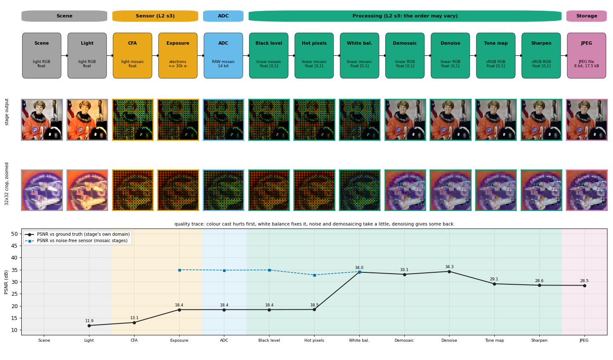
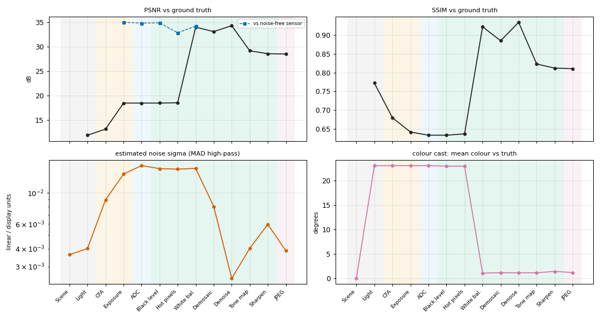

# 00 - The camera pipeline



## 1. In one paragraph
A digital camera is a chain: a **sensor** turns light into charge, an **ADC** turns charge into numbers, a stack of **processing** steps turns the RAW numbers into a picture, and the picture is **stored** as a JPEG (L2 s3). The slide says three things about that chain: every camera uses different algorithms, *the processing order may vary*, and most of it is proprietary. `isp.pipeline` builds a readable version of it out of the modules of this toolkit. Every stage is a plain function `fn(image, meta, **params) -> (image, meta)`, so you can run the whole camera, look at what each stage did to the picture, measure it against the ground truth, switch stages off, change their parameters and put them in a different order. The other docs (01 to 07) explain one stage each; this one explains how they fit together.

## 2. Theory: the slides mapped to stage ids
**Slide 3 (camera pixel pipeline)** has four boxes: sensor, ADC, processing (demosaicing, tone mapping and white balancing, denoising and sharpening, compression) and storage. We add a box on the left, the *scene*, because a simulator needs a ground truth and a light source.

**Slide 34 (various sensor noise)** is the block diagram of the sensor: radiant power plus dark current, times exposure time, photon noise, sensor saturation, readout noise, gain `1/g`, ADC noise, quantised digital value. It is split in two by the stages `exposure` and `adc`:

| Block of L2 s34 | Stage | What our code does |
|---|---|---|
| radiant power, exposure time `t` | `exposure` | photons = scene x `flux_at_white`; electrons = photons x QE x `t` (PRNU gain error) |
| dark current `D` | `exposure` | `(D + DSNU + hot pixels) t` added to the mean |
| photon noise | `exposure` | Poisson draw of the electron count |
| sensor saturation | `exposure` | clip at the full-well capacity |
| readout noise | `adc` | Gaussian noise of `N_r` electrons |
| gain factor `1/g` | `adc` | `iso` (DN per electron = base gain x iso / 100) |
| ADC noise, quantised value | `adc` | black level added, rounding to `bits`, clipping at the white level |

The processing stages then undo what the sensor did: `black_level` removes the offset, `hot_pixels` removes defects, `white_balance` removes the colour of the light, `demosaic` re-creates the two thirds of the colour samples the CFA discarded, `denoise` removes noise, `tonemap` turns light into display values, `sharpen` restores crispness and `jpeg` stores the result.

**Data domains.** The images change meaning along the chain (docs/conventions.md): `scene` (linear light) -> `electrons` -> `dn` (RAW numbers) -> `linear` (normalised) -> `display` (sRGB-encoded) -> `bytes` (decoded JPEG). `meta['domain']` always says which one a record is in, and `meta['cfa']` is present only while the image is still a single-plane mosaic.

## 3. Algorithm
`isp.pipeline.default_pipeline()` returns the 13 stages below, in this order. `simulate()` loads a scene, runs them and attaches metrics.

| id | Group (box of L2 s3) | What it does | Domain out | Bits | Module | Doc |
|---|---|---|---|---|---|---|
| `scene` | scene | ground truth, identity | scene RGB | float | `scenes` | this file |
| `illuminant` | scene | black-body colour cast (default 3200 K) | scene RGB | float | `whitebalance` | [03](03_white_balance.md) |
| `cfa` | sensor | Bayer sampling, `meta['cfa']` | scene mosaic | float | `cfa` | [02](02_color_sensing_demosaicing.md) |
| `exposure` | sensor | photons, QE, shot noise, dark current, hot pixels, PRNU, full well | electrons mosaic | float, up to the full well | `sensor` | [01](01_sensor_and_noise.md) |
| `adc` | adc | read noise, ISO gain, black level, quantisation | `dn` mosaic | 14 (preset; `bits=` overrides) | `sensor` | [01](01_sensor_and_noise.md) |
| `black_level` | processing | subtract black (and optionally a master dark frame), normalise, digital gain | `linear` mosaic | float | `sensor` | [01](01_sensor_and_noise.md) |
| `hot_pixels` | processing | median of same-colour neighbours replaces outliers | `linear` mosaic | float | `sensor` | [01](01_sensor_and_noise.md) |
| `white_balance` | processing | gains on the mosaic, estimated from a 2x2-binned RGB | `linear` mosaic | float | `whitebalance` | [03](03_white_balance.md) |
| `demosaic` | processing | interpolation to RGB | `linear` RGB | float | `demosaic` | [02](02_color_sensing_demosaicing.md) |
| `denoise` | processing | bilateral filter | `linear` RGB | float | `denoise` | [05](05_denoising.md) |
| `tonemap` | processing | sRGB curve | `display` RGB | float [0, 1] | `tonemap` | [04](04_tone_mapping.md) |
| `sharpen` | processing | unsharp mask | `display` RGB | float [0, 1] | `sharpen` | [06](06_sharpening.md) |
| `jpeg` | storage | own JPEG codec, decoded | `bytes` RGB | 8 (stored) | `jpeg` | [07](07_compression.md) |

`isp.pipeline.STAGE_INFO` holds the label, a one-line summary, a short description, the slide numbers, the doc and the help text of every parameter of every stage; `GROUP_INFO` holds the group labels and colours (the same colours as the figure). The app and the README read them.

**Default parameters** (`isp.pipeline.DEFAULT_PARAMS`), and why:

| stage | defaults | reason |
|---|---|---|
| `illuminant` | `cct=3200` | tungsten light: R x 1.81, B x 0.35 relative to green, a cast of 23 degrees that white balance has to remove |
| `exposure` | `sensor='dslr'`, `exposure=1/80 s`, `flux_at_white=1e5`, hot pixels 0.05 % at 40 000 e-/s | dim light: scene white gives 500 e- (green). Shot noise is then about 4.5 % at white and more in the shadows |
| `adc` | `iso=3200`, 14 bit | the product `ISO x t` puts scene white at about half of the ADC range (the red channel under tungsten reaches 0.97 of the range and practically does not clip (0.02 % of the pixels)); high ISO with a short exposure is the typical noisy phone / low-light shot |
| `black_level` | `dark_frame=False`, `digital_gain=1` | the dark frame is an opt-in calibration (it costs 16 simulated exposures) |
| `hot_pixels` | `threshold=0.3` | defects reach 0.5 of full scale; real detail that deviates more than 0.3 from its same-colour neighbours stays untouched (see doc 08 for the false positives of lower thresholds) |
| `white_balance` | `method='white_patch'` | on the default scene white patch finds the lamp to 0.8 degrees, gray world is off by 10.6 degrees (the astronaut is not grey on average); gray world is one parameter away |
| `demosaic` | `method='median'` | Freeman's median demosaic is slightly better than Malvar on the noisy default: 33.08 dB vs 32.85 dB, SSIM 0.885 vs 0.874 (bilinear 31.79 dB). The median filter on the colour differences also removes colour noise; on a noise-free image Malvar is the better one (doc 02) |
| `denoise` | bilateral `sigma_d=1.5`, `sigma_r=0.05` | picked on a small grid (`sigma_d` 1 to 2, `sigma_r` 0.03 to 0.12) by display-domain PSNR and SSIM on two photographs, `sigma_r` a little above the noise std so that noise is smoothed but edges are kept |
| `tonemap` | `srgb` | the camera default curve |
| `sharpen` | unsharp, `lam=0.5`, `sigma=1` | modest: it recovers some crispness without making the remaining noise worse (doc 06) |
| `jpeg` | `quality=85`, `4:2:0` | a typical camera setting |

## 4. Implementation notes
**Stage contract.** `fn(image, meta, **params) -> (image, meta)`; no stage modifies its inputs, every stage returns `float32` and a new meta dict. Stages that cannot work on the data they receive raise a `ValueError` that names the stage and says what it needed.

**Order rules** (what you can move, what raises):

* `illuminant` and `exposure` need scene-domain light, `adc` needs electrons, `black_level` needs DN, so *adc before exposure* or *black_level before adc* raises. The sensor half of the chain is physics and has one order.
* `white_balance` and `tonemap` need linear (or scene) data; `tonemap` also needs RGB. `white_balance` works on a mosaic (default) or on RGB, so it can move after `demosaic`; it then applies RGB gains.
* `demosaic` passes an RGB image through (so switching `cfa` off does not crash the pipeline), `cfa` passes a mosaic through.
* `denoise` on a mosaic filters each of the four CFA site planes separately, so colours are never mixed; `luma_chroma` needs RGB and raises on a mosaic.
* `hot_pixels` works on a mosaic or RGB; `sharpen` needs RGB; `jpeg` accepts anything and stores a mosaic as a grey image (so "all processing off" still runs: what you get is the grey RAW, JPEG-compressed).
* Switching a stage off (`enabled=False`) passes the data through. `black_level` cannot be skipped because every later stage wants linear data.

**Meta keys** set by the stages: `illuminant` (CCT), `cfa`, `sensor`, `sensor_params` (dict, so the ADC and the dark frame use the same sensor), `exposure`, `flux_at_white`, `full_well`, `iso`, `bits`, `black_level`, `white_level`, `wb_gains`, `wb_method`, `wb_angular_error`, `tonemap`, `nbytes`, `bpp`, `quality`, `subsampling`, and `scene_scale`.

**`scene_scale`** is the factor by which exposure, ISO and digital gain turned one unit of scene value into linear units: `flux x QE x t / full_well` at `exposure`, times `ISO / 100` at `adc`, times `digital_gain` at `black_level`, times the green gain at `white_balance`. The metrics use it so that a different brightness choice is not counted as an error.

**Running.**

* `Pipeline.run(image, meta=None, metrics=None, start=None, previous=None)`. `start='black_level'` skips the earlier stages (a real RAW enters there, see `isp.io.load_raw` and `pipeline.process_raw`). `previous=` is an earlier result: the longest prefix of stages with the same id, function, enabled flag, parameters and input image is copied (`record.reused = True`), everything after the first change is recomputed. The result is identical to a full run. Moving the sharpen slider recomputes two of 13 stages (59 ms instead of 265 ms at 256 x 256 on the development machine, `previous=` with `simulate`).
* Every record has `seconds`; the whole default camera takes about 0.12 s at 256 x 256 (the bilateral filter is the largest part).
* `isp.display.render(record)` turns any stage output into a viewable `uint8` image (mosaics through `cfa.colorize`, linear data through the sRGB curve); `stage_thumbnails`, `crop_zoom`, `difference`, `histograms` and `to_data_uri` are there for the app. `isp.display` uses no matplotlib.

**Metrics** (`isp.pipeline.StageMetrics`, passed to `run(metrics=...)`; `simulate` does it for you). The reference of a stage output depends on its domain; `truth` is the ground-truth scene and `scene_scale` is read from the stage's own meta:

| the stage output is | reference | notes |
|---|---|---|
| `scene`, `illuminant` | the unlit truth | the cast is the error: 11.9 dB |
| a mosaic (`cfa`, `exposure`, `adc`, `black_level`, `hot_pixels`, `white_balance`) | `clip(cfa.mosaic(truth) x scale)` | electrons are divided by the full well x ISO / 100, DN by `(DN - black) / (white - black)`, so all the mosaic stages are on one scale |
| `linear` RGB (`demosaic`, `denoise`) | `clip(truth x scale)` | so the demosaic stage pays for its interpolation |
| `display` / `bytes` RGB (`tonemap`, `sharpen`, `jpeg`) | the same scaled truth through the same tone-mapping stage | e.g. through the sRGB curve |

Per stage: `psnr` (dB, peak 1), `ssim` (scikit-image, on [0, 1] data), `sigma` (estimated noise std of the stage output in its own units: `denoise.estimate_noise`, the MAD of a high-pass response; on a mosaic, the mean over the four site planes), `cast_deg` (angle between the mean colour of the output and the mean colour of the truth, in linear RGB), `wb_angular_error` (white-balance stage and everything after it, only if the illuminant is known) and, for the stages that still hold a mosaic after the sensor, `psnr_noise`: PSNR against the *noise-free expected value of the same stage*. That reference comes from an oracle run of the same stages with `oracle=True` in `exposure`, `adc` and `black_level`: no Poisson noise, no read noise, no rounding, no hot pixels, no PRNU, same dark current and full-well clipping; `hot_pixels` and `denoise` are skipped in the oracle (they remove nothing from it). It isolates noise from the colour cast, which dominates `psnr` before white balance. Estimating the noise with the MAD of a high-pass is biased up on textured or small images (it reads 0.0036 on the noise-free scene itself), so look at trends, not absolute values.

**The quality trace of the default run** (astronaut, 256 x 256; `scripts/make_figures_pipeline.py`):

| stage | PSNR (dB) | SSIM | sigma | cast (deg) | PSNR vs noise-free |
|---|---|---|---|---|---|
| `scene` | inf | | 0.0036 | 0.0 | |
| `illuminant` | 11.85 | 0.772 | 0.0040 | 23.0 | |
| `cfa` | 13.10 | 0.680 | 0.0089 | 23.1 | |
| `exposure` | 18.44 | 0.642 | 0.0136 | 23.1 | 34.98 |
| `adc` | 18.44 | 0.633 | 0.0157 | 23.1 | 34.82 |
| `black_level` | 18.44 | 0.633 | 0.0149 | 23.0 | 34.87 |
| `hot_pixels` | 18.49 | 0.637 | 0.0148 | 23.0 | 32.83 |
| `white_balance` | 33.98 | 0.922 | 0.0150 | 1.1 | 34.21 |
| `demosaic` | 33.08 | 0.885 | 0.0080 | 1.2 | |
| `denoise` | 34.29 | 0.934 | 0.0025 | 1.2 | |
| `tonemap` | 29.14 | 0.823 | 0.0040 | 1.2 | |
| `sharpen` | 28.55 | 0.812 | 0.0060 | 1.5 | |
| `jpeg` | 28.48 | 0.810 | 0.0039 | 1.2 | |

How to read it. The light cast (23 degrees) is the first and by far the largest loss; nothing before `white_balance` can fix it, and then it jumps by 15.5 dB (the wb estimate is 0.76 degrees off). Noise appears at `exposure` and `adc`: against the noise-free sensor the mosaic is at about 35 dB, and the PSNR is the same at `adc` and `exposure` because the ISO gain scales both the same way. The `hot_pixels` stage lowers `psnr_noise` by 2 dB: its median also replaces some real detail (see the threshold sweep in doc 08: far more pixels are replaced than there are defects). `demosaic` costs 0.9 dB; `denoise` gives back 1.2 dB and cuts the noise estimate from 0.0080 to 0.0025. The jump down at `tonemap` is not a loss of the tone curve itself: the same linear error is amplified in the shadows by the steep start of the sRGB curve, so display-domain PSNR is lower than linear PSNR for the same image. `sharpen` lowers PSNR a little (it amplifies noise; SSIM falls too here) and `jpeg` costs 0.07 dB for 17 498 bytes (2.14 bits per pixel).



## 5. Experiments
The ablations (every processing stage off in turn, orders, noisy vs clean RAW into JPEG, ISO vs exposure, bit depth) are in [08_pipeline_experiments.md](08_pipeline_experiments.md). Two choices of the default camera are measured above (demosaic, white balance); the sections of docs 01 to 07 contain the per-stage experiments.

## 6. Try it
```python
import isp
from isp import pipeline as P, display, io

res = P.simulate('astronaut', size=256)            # default camera, metrics included
print(res.names)                                   # the 13 stage ids
print(res['white_balance'].meta['wb_gains'], res['white_balance'].metrics['wb_angular_error'])
print(res.final.meta['nbytes'], 'bytes JPEG,', round(res.final.metrics['psnr'], 1), 'dB')
io.save_png(display.render(res.final), 'photo.png')      # any stage can be rendered: display.render(res['adc'])

# change parameters (stage id -> params), switch a stage off, or use another scene
res2 = P.simulate('coffee', adc={'iso': 6400}, white_balance={'method': 'gray_world'},
                  enabled={'denoise': False})

# edit and reorder a pipeline yourself
pl = P.default_pipeline()
pl.set('jpeg', quality=30).move('denoise', before='demosaic')    # denoise the mosaic's colour planes
res3 = P.simulate('astronaut', pipeline=pl)

# incremental re-run: only the stages after the first changed one are recomputed
res4 = P.simulate('astronaut', previous=res, sharpen={'lam': 1.0})
print([r.reused for r in res4])

# your own stage: any fn(image, meta, **params) -> (image, meta)
import numpy as np
def vignette(img, meta, strength=0.3):
    h, w = img.shape[:2]
    y, x = np.ogrid[:h, :w]
    r2 = ((y - h / 2) / (h / 2)) ** 2 + ((x - w / 2) / (w / 2)) ** 2
    return (img * (1 - strength * r2)[..., None]).astype(np.float32), meta
pl2 = P.default_pipeline()
pl2.stages.insert(2, isp.Stage('vignette', vignette, {'strength': 0.4}, group='scene'))
res5 = P.simulate('astronaut', pipeline=pl2)

# a real RAW file (needs the optional rawpy package): enters at black_level
# mosaic, meta = io.load_raw('photo.dng'); res = P.process_raw(mosaic, meta, white_balance={'method': 'camera'})
```

## 7. Limitations and extensions
* One order of the sensor, one Bayer sensor: no multi-frame capture, no lens (vignetting, blur, chromatic aberration), no auto-exposure or autofocus, no colour matrix from camera RGB to sRGB. The illuminant is a black body and the scene is lit uniformly; `scenes` have no spectral data.
* The metrics compare with a single ground truth through the same tone curve; they do not model what a person would prefer (sharpening, local tone mapping and contrast boosts all lose PSNR). The oracle for `psnr_noise` is exact only for the stages before demosaicing.
* Gains are estimated from the data that is there: gray world and white patch can fail (doc 03), and so the default `white_patch` can on a scene without white. The pipeline records `wb_angular_error` only because it knows the light.
* Extensions to try: a colour matrix stage, a dark-frame / flat-field calibration stage that is part of `black_level`, a per-stage cost model (bits, bytes, seconds), the same pipeline on a real RAW file, and a learned denoiser as a drop-in stage.

## 8. References
* Levoy, M. *Digital Photography* course slides (L2 Sensors and Noise, s3 camera pixel pipeline, s34 sensor noise block diagram; L3 Sensing Color; L4 White Balancing and Tone Mapping; L5 Denoising, Sharpening, Compression), as in docs/conventions.md.
* Ramanath, R., Snyder, W. E., Yoo, Y., Drew, M. S. "Color image processing pipeline." *IEEE Signal Processing Magazine* 22(1), 2005.
* Karaimer, H. C., Brown, M. S. "A software platform for manipulating the camera imaging pipeline." *ECCV* 2016.
* Healey, G. E., Kondepudy, R. "Radiometric CCD camera calibration and noise estimation." *IEEE TPAMI* 16(3), 1994.
