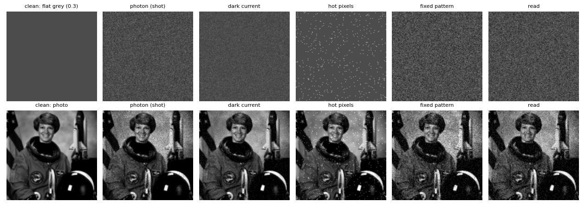
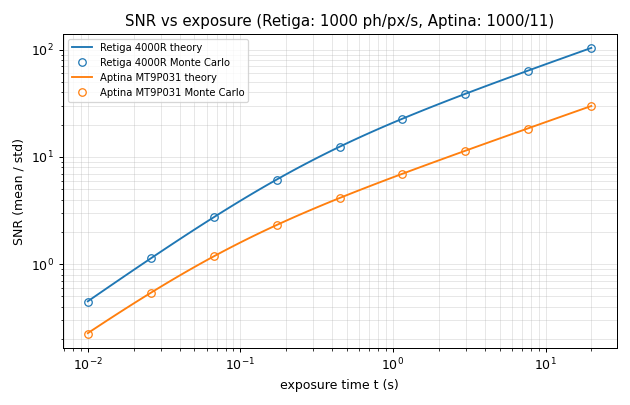
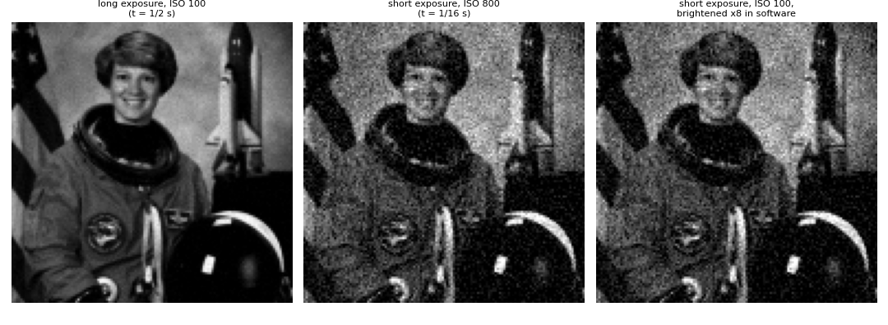
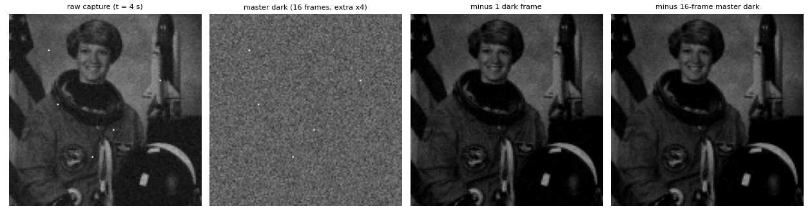
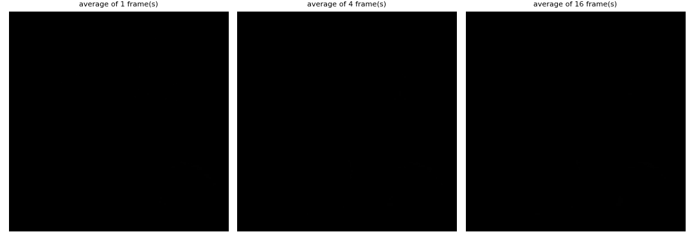
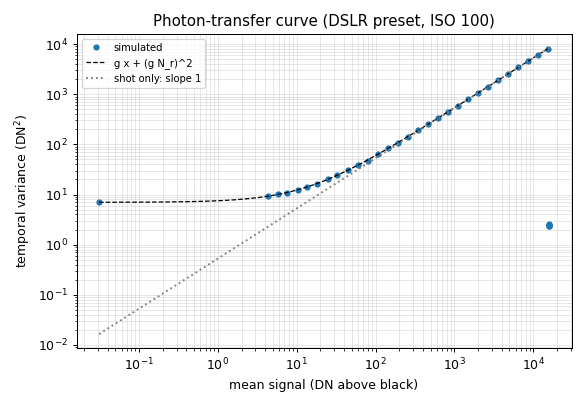
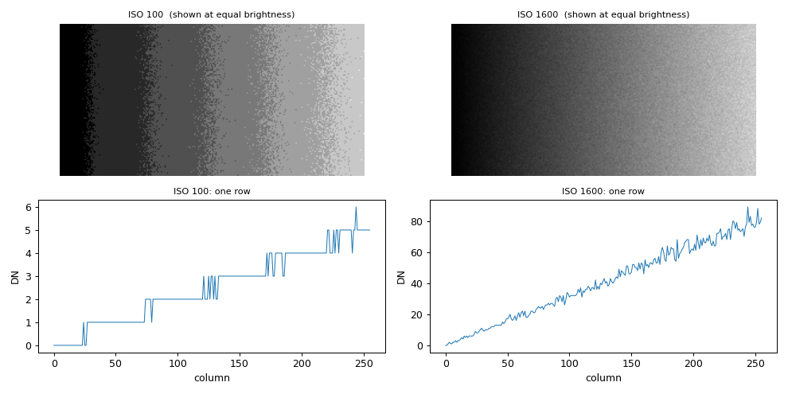

# 01. Sensor and noise

Code: `isp/sensor.py`, `tests/test_sensor.py`, `scripts/make_figures_sensor.py`.
Lecture 2 slides 3, 6-10, 13, 18-34, 36-43 (L2 sNN = PDF page NN).

## 1. In one paragraph

A sensor does not measure light, it counts electrons.  Photons arrive randomly,
the silicon adds its own charge and its own imperfections, an amplifier applies
the ISO gain, and an ADC rounds the result to an integer.  Every later stage of
the camera pipeline (demosaicing, white balance, denoising) inherits this noise,
so it pays to know where each part comes from and which part can be removed.
`isp.sensor` simulates the chain of L2 s34 pixel by pixel, in physical units
(electrons, seconds), and gives you the closed-form SNR and dynamic range of
L2 s31-33 to check the simulation against.

## 2. Theory

### 2.1 The chain (L2 s34)

```
radiance -> (+ dark current) x t -> photon noise -> saturation -> + read noise -> gain -> ADC -> DN
```

For a pixel with photon flux `P` (photons/s), quantum efficiency `Q_e`, exposure
`t`, dark current `D` (e-/s) and read noise `N_r` (e- rms):

- charge: `n = Poisson(P Q_e t + D t)`, clipped at the full well;
- readout: `DN = round(g (n + N(0, N_r^2)) + black)`, with `g = g_100 * ISO/100`
  in DN per electron.

### 2.2 Noise types (L2 s18-30)

| source | statistics | removable? |
|---|---|---|
| photon (shot) noise | Poisson, variance = mean signal | no, set by physics |
| dark current | Poisson on `D t`; mean grows with `t` and temperature | its mean yes (dark frame); its shot noise no |
| hot pixels | a few pixels with huge `D` | yes: dark frame or median fix |
| fixed pattern (PRNU, DSNU) | the same every shot; gain error and dark offset | yes: read once, subtract (s28-29) |
| read noise | Gaussian, independent per readout | no (cooling at best, s30) |
| quantisation | uniform, variance 1/12 DN^2 | no, but irrelevant if noise >> 1 DN |

### 2.3 SNR (L2 s31-32)

Independent noise sources add in variance, `sigma^2 = sigma_photon^2 + sigma_dark^2 + sigma_read^2`, so

$$\mathrm{SNR}=\frac{P Q_e t}{\sqrt{P Q_e t + D t + N_r^2}}$$

Two regimes follow.  When the signal is large, SNR `~ sqrt(P Q_e t)`: shot-noise
limited, doubling the exposure gains `sqrt 2`.  When it is small, SNR `~ P Q_e t / N_r`:
read-noise limited, SNR grows linearly with exposure.

Slide 32 examples (reproduced by `snr_theory`): Retiga 4000R at 1000 photons/px/s,
1 s: **20.8:1**; Aptina MT9P031 with pixels 1/11 the area (`P = 1000/11`): **6.5:1**.

### 2.4 Dynamic range (L2 s33)

$$\mathrm{DR}=\frac{\text{full well}-D t}{\sqrt{D t+N_r^2}}$$

Largest signal over the noise floor in the dark.  Slide values reproduced by
`dynamic_range`: Retiga 3313:1 (1 s) and 3333:1 (1/60 s); Aptina ~1500:1 (1 s)
and ~3200:1 (1/60 s).  The Aptina drops at long exposure because its dark current
(25 e-/s) eats the well and adds noise.

### 2.5 ISO and exposure (L2 s36-39)

ISO multiplies the signal **and** the noise that exists before the amplifier, so
it does not change the electron-domain SNR.  It only decides where the signal
sits relative to the ADC step.  More light (longer exposure, wider aperture) is
the only way to improve SNR.  Raising ISO after the fact is the same as
brightening in software, except that it also hides quantisation.

## 3. Algorithm

1. `fixed_pattern(shape, params)`: draw PRNU, DSNU and hot-pixel maps from a seed
   stored in `params.sensor_seed` (not the per-shot seed).
2. `expose`: mean electrons `P Q_e t (1+PRNU) + (D + DSNU + hot) t`; draw Poisson;
   clip at `full_well`.
3. `adc`: add `N(0, N_r^2)` electrons, multiply by `g`, add `black_level`, round,
   clip to `[0, 2^bits - 1]`.
4. `capture` = `expose` + `adc`, returns `(dn, meta)`.
5. Calibration: `dark_frame` / `master_dark` (average of dark frames),
   `subtract_dark`, `fix_hot_pixels`, `average_frames`, `normalize`.

## 4. Implementation notes

- `SensorParams.base_gain=None` means "full well maps to white level":
  `g_100 = (2^bits - 1 - black) / full_well`.  `gain(iso)` scales it linearly.
- Fixed pattern depends on `(sensor_seed, shape)` only, so two shots of the same
  size see the same hot pixels and the same PRNU.  This is what makes dark-frame
  subtraction work; a different `seed` changes only the temporal noise.
- Input is linear scene value in `[0, 1]`; `flux_at_white` (default 1e5
  photons/px/s) says how many photons "1.0" delivers.  Works for mosaics and RGB.
- `fix_hot_pixels` compares each pixel with the median of its 8 same-colour
  neighbours (stride 2 on a mosaic) and replaces it only if it is *brighter* by more
  than 8 robust sigmas.  It cannot tell a hot pixel from a one-pixel star.
- `subtract_dark(dn, dark, black_level)` adds the black level back so the result
  stays in the DN convention.  Results are not clipped.
- `measure_snr` uses the temporal std of each pixel, so fixed pattern is not
  counted as noise, and reports the signal charge without the dark offset, as in
  the numerator of the SNR formula.
- `photon_transfer` takes the variance from the difference of two shots / 2 (again
  fixed-pattern free).
- Quantisation is the only "ADC noise" modelled.

## 5. Experiments

All numbers are printed by `python scripts/make_figures_sensor.py`.

### 5.1 Noise gallery



Each column isolates one source on a flat grey (top) and on a photo (bottom),
exaggerated so that all of them are visible (white = 120 e-).  On the flat patch
(0.3 of white): shot 6.0 e- (theory `sqrt 36` = 6.0), dark-current shot 3.9 e-
(`sqrt 15` = 3.9), read 8.0 e-, hot pixels sparse bright dots, fixed pattern 8.6 e-.
Look at how shot noise follows the image (brighter regions are noisier in absolute
terms) while read noise does not, and how the FPN column looks like noise but would
repeat exactly in the next shot.

### 5.2 SNR vs exposure



Lines are `snr_theory`, circles are Monte Carlo (48 frames of 32x32, fixed pattern
off, 16-bit ADC).  The agreement is within 0.8 % (Retiga) and 2.0 % (Aptina) over
0.01-20 s.  The slope is 1 at short exposures (read-noise limited) and bends to 1/2
(shot-noise limited); the Aptina curve flattens at long exposures where dark-current
shot noise competes.  Theory at 1 s: 20.85:1 and 6.45:1 (slide: 20.8, 6.5).
Dynamic range: Retiga 3314:1 (1 s), 3333:1 (1/60 s); Aptina 1504:1 and 3173:1.

### 5.3 Exposure vs ISO



Dim scene (patch 0.08), read noise 15 e-, all three shown at equal brightness.
Left: 1/2 s, ISO 100 (1600 e-, SNR 37.2).  Middle: 1/16 s, ISO 800 (200 e-, SNR 9.7).
Right: 1/16 s, ISO 100 then brightened x8 in software (SNR 9.7).  Short exposure at
high ISO and short exposure brightened later are the same image: ISO bought nothing
except a lighter-looking file.  The 8x light of the long exposure bought 3.8x SNR
(`sqrt 8` = 2.8 from shot noise, more because read noise matters less).

### 5.4 Dark-frame subtraction



Aptina preset, 4 s exposure.  RMS error against the noise-free image: raw 49.9 DN,
minus one dark frame 9.1 DN, minus a 16-frame master dark 7.7 DN.  The floor is
the shot noise of signal and dark charge, about 7.4 DN, which no subtraction
removes.  The 5 hot pixels (raw excess 572 DN) fall to 8 DN.  One dark frame is
worse than the master because its own read noise is subtracted from the image;
averaging dark frames keeps the fixed pattern and averages the rest away.

### 5.5 Averaging frames



Noise std against the 256-frame mean: 6.30 DN (1 frame), 3.17 (4), 1.65 (16); ratios
1.99 and 3.81 versus `sqrt M` = 2 and 4 (L2 s43 and the usual stacking trick).  PSNR
rises 68.3, 74.4, 80.7 dB.  The 16-frame ratio is a little low only because the
reference mean is itself noisy.  Averaging fixes random noise, not fixed pattern.

### 5.6 Photon-transfer curve



Variance of the temporal noise against mean signal, log-log.  Flat floor at
`(g N_r)^2` (read noise recovered: 5.00 e-, true 5.0), then slope 1 where shot noise
dominates; the fitted slope is 0.531 DN/e- against the true gain 0.529.  Beyond full
well the variance collapses because every pixel is clipped.  This is how real camera
gain and read noise are measured.

### 5.7 Quantisation at low signal



8-bit ADC, a very dark ramp (0 to 3 % of white), same exposure.  ISO 100 produces
7 output levels (visible bands, steps in the row plot); ISO 1600 spreads the same
ramp over 91 levels.  The electron SNR is the same in both, quantisation is only
cheap to avoid when the gain is high enough.  This is the one real reason to use
a high ISO on a low-bit sensor.

## 6. Try it

```python
import numpy as np
from isp import sensor as S, scenes

p = S.PRESETS['dslr']
img = scenes.load('astronaut', 128).mean(axis=2) * 0.1     # a dark scene
dn, meta = S.capture(img, exposure=1/30, iso=800, params=p, seed=0)
print(meta)
print(S.measure_snr(p, value=0.1, exposure=1/30, iso=800))
print(S.snr_theory_params(0.1, 1/30, p))
linear = S.normalize(dn, meta)           # in [0, 1] for the next stage
```

## 7. Limitations and extensions

- One PRNU and one DSNU level, i.i.d. per pixel.  Real CMOS sensors have row and
  column pattern noise (L2 s29-30 show it); adding `r[:, None] + c[None, :]` is a small extension.
- Dark current is temperature independent; it roughly doubles every 6 K.
- No lens, blooming, charge transfer, or rolling shutter.
- ADC noise beyond rounding, and non-linearity, are not modelled.
- Hot-pixel detection assumes a mostly smooth neighbourhood.  Try it on a star field.
- Try: estimate gain and read noise of a "mystery" `SensorParams` from
  `photon_transfer` alone.

## 8. References

- M. Levoy, *Computational Photography*, lecture slides "Sensors and Noise"
  (Stanford CS 448 / lecture 2 of this course), slides cited as L2 sNN.
- Hamamatsu, *Concepts in digital imaging: CCD signal-to-noise ratio*,
  learn.hamamatsu.com (source of the SNR formula on L2 s31).
- J. Janesick, *Photon Transfer*, SPIE Press, 2007.
- EMVA Standard 1288, *Characterization of image sensors and cameras*.
