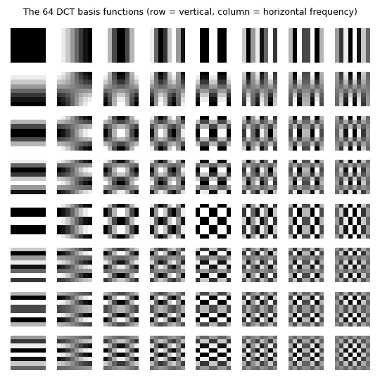
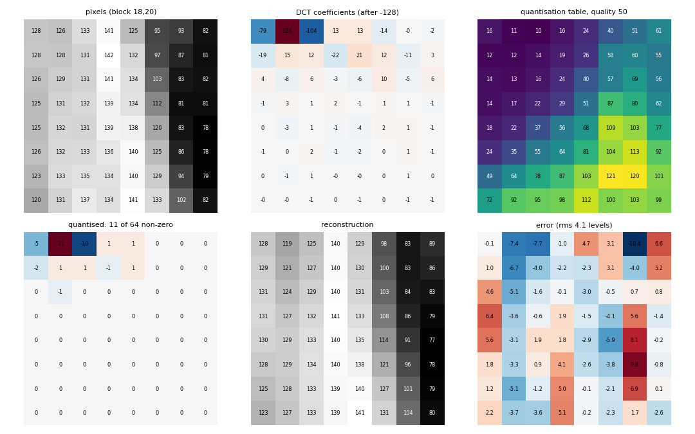
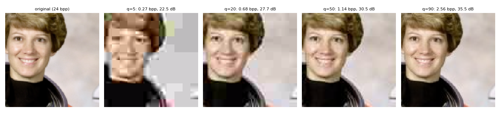
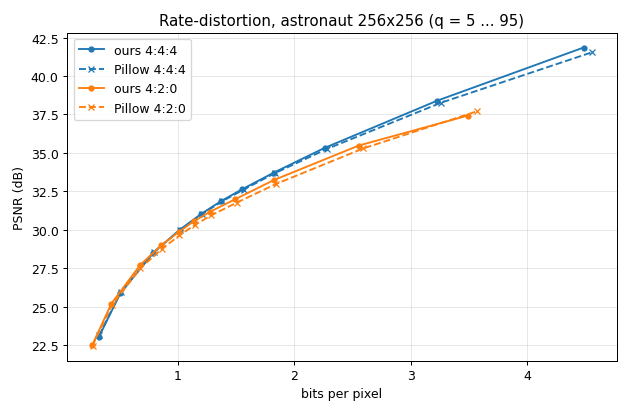
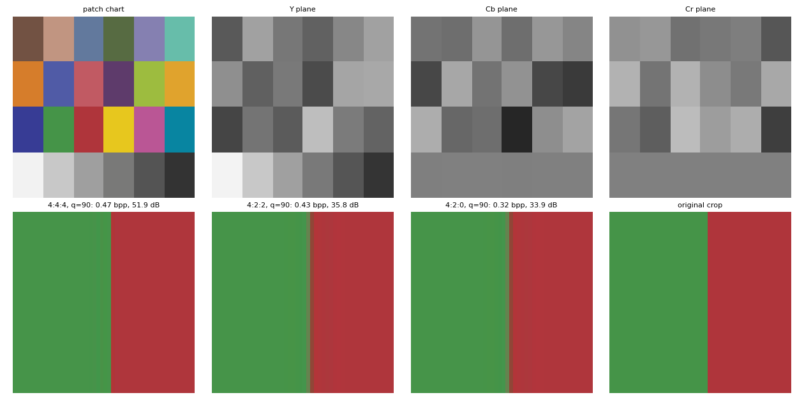
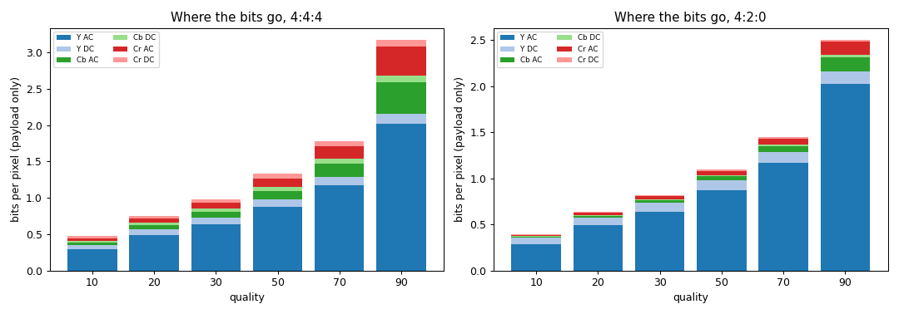
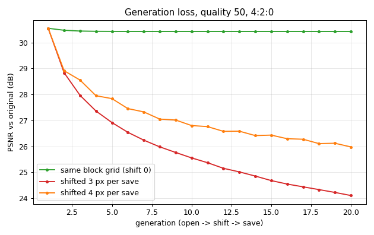
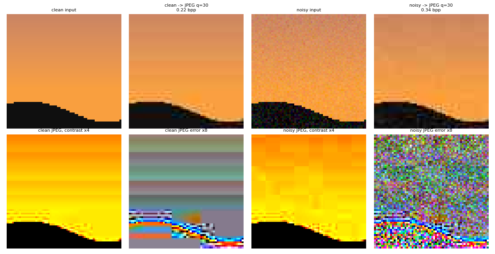
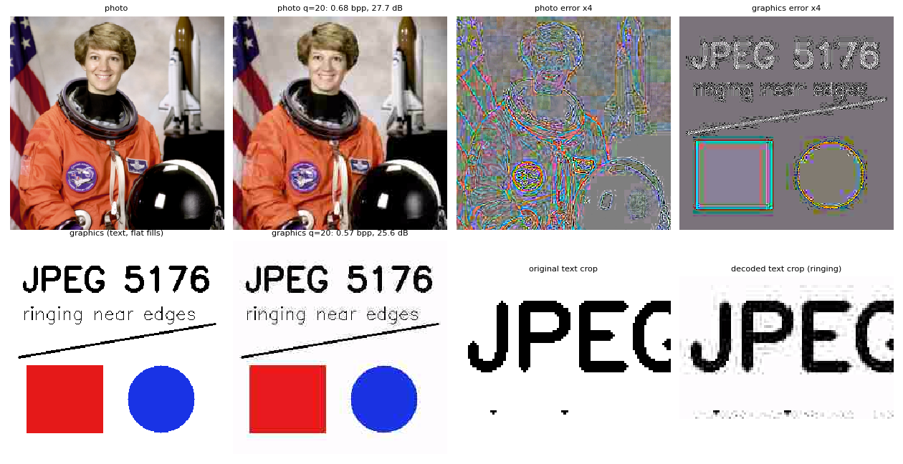
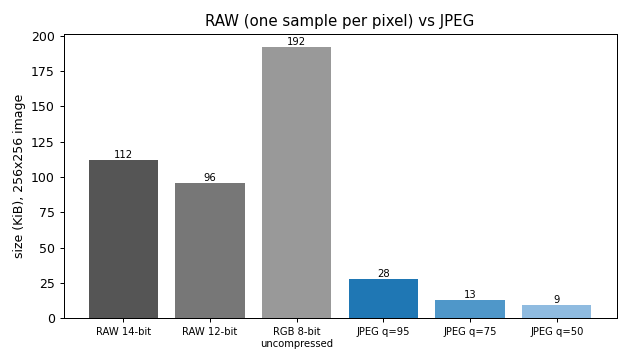

# 07 - Compression and storage: baseline JPEG

Module `isp/jpeg.py`; tests `tests/test_jpeg.py`; figures `scripts/make_figures_jpeg.py` (all numbers below are printed by it; test image: `astronaut`, 256x256, sRGB-encoded, unless noted).

## 1. In one paragraph
The last box of the camera pipeline stores the picture. JPEG turns 24 bits per pixel into about 1-3 by throwing away what the eye barely sees: detail in colour (chroma subsampling) and fine, low-amplitude spatial detail (quantised DCT coefficients). What is left is entropy coded. The price is that it is lossy, it is designed for natural scenes rather than drawings (L5 s19), and every open-edit-save cycle that moves the 8x8 grid costs quality again. This module is a small but faithful baseline codec: its sizes agree with libjpeg within about 2 % (section 5).

## 2. Theory
**Codec chain (L5 s20).** RGB -> YCbCr -> (chroma subsampling) -> 8x8 blocks -> DCT -> quantisation -> entropy coding; the decoder runs the same boxes backwards.

**Colour.** Y carries luminance, Cb and Cr the colour differences (full-range BT.601, `utils.rgb_to_ycbcr`). The eye resolves colour much more coarsely than luminance, so Cb and Cr are averaged over 2x1 (`4:2:2`) or 2x2 (`4:2:0`) pixels. That alone removes half of the samples in 4:2:0 (1 + 1/4 + 1/4 = 1.5 instead of 3 samples per pixel).

**DCT.** Each block (level-shifted by 128) is projected on 64 cosine patterns
$$F(u,v)=\sum_{x,y} f(x,y)\,c_u[x]\,c_v[y],\qquad c_k[n]=a_k\cos\frac{(2n+1)k\pi}{16},$$
with $a_0=\sqrt{1/8}$, $a_{k>0}=\sqrt{2/8}$. The transform is orthonormal, so it loses nothing by itself and quantisation error in coefficients equals error in pixels (Parseval). It helps because natural blocks are smooth: energy piles up in the few low-frequency coefficients (`jpeg_dct_basis.png`, L5 s20).

**Quantisation is the only lossy step.** $\hat F=\mathrm{round}(F/Q)$ with an 8x8 table $Q$ that is large for high frequencies and for chroma. The quality knob $q\in[1,100]$ scales the Annex K tables (IJG rule): scale $=5000/q$ for $q<50$ else $200-2q$, $Q=\mathrm{clip}(\lfloor(Q_{50}\cdot\text{scale}+50)/100\rfloor,1,255)$. $q=50$ gives the standard tables, $q=100$ all ones.

**Entropy coding (lossless).** Zig-zag scan orders the 64 coefficients from low to high frequency, so the zeros bunch at the end. DC coefficients are coded as differences to the previous block of the same component. AC coefficients become symbols (run of zeros, size of the value), with EOB for "rest is zero" and ZRL for 16 zeros. Symbols get Huffman codes, and each value adds `size` amplitude bits. Frequent symbols (the zero runs of smooth blocks) cost 2-4 bits, so smooth content is cheap and noise is expensive.

**Why shifting hurts (L5 s19).** Re-encoding the decoded picture on the *same* grid with the *same* tables is almost a projection: the coefficients already sit near multiples of $Q$, so little changes. If the picture is cropped or moved by 4 pixels, every new block straddles old block borders, its coefficients are new, and a fresh rounding error is added.

## 3. Algorithm
Encoder (`encode`):
1. RGB -> YCbCr, scale to 0..255, subtract 128.
2. Pad to whole MCUs (16x16 for 4:2:0) by replicating the edge; box-average Cb, Cr.
3. Split into 8x8 blocks, orthonormal DCT-II (`scipy.fft.dctn`, vectorised over blocks).
4. Divide by $Q_Y$ (Y) or $Q_C$ (Cb, Cr), round to integers.
5. Per component, in MCU scan order: zig-zag, DC differences, AC (run, size) symbols.
6. Build optimal Huffman tables from the symbol counts (luma DC/AC, chroma DC/AC), count code bits plus amplitude bits, add header estimate.

Decoder (`decode`): dequantise, inverse DCT, +128, merge blocks, bilinear chroma upsampling, YCbCr -> RGB, round to 8 bits, clip, crop to the original size.

## 4. Implementation notes
* **API.** `quant_tables`, `dct_basis` (`B[u, v, x, y]`), `encode -> JPEGData`, `decode`, `roundtrip -> (img, info)` with `nbytes, bpp, psnr, ratio` (24 bpp / bpp), `pillow_roundtrip -> (img, nbytes)` (real libjpeg, `optimize=True`), `generation_loss(img, n, quality, shift)`. Extras: `block_dct`, `block_before_after`, `blockiness`, `zigzag`, `rle_encode_ac / rle_decode_ac`, `huffman_lengths / huffman_codes / huffman_encode / huffman_decode`, `read_exif`, `write_jpeg_with_exif`, `raw_vs_jpeg_size`.
* **Huffman tables are optimal, not the Annex K defaults.** They are built from the image's own symbol statistics, like libjpeg `optimize_coding`: tree by merging the two lightest nodes, depth limited to 16 with the Annex K.2 adjustment, a dummy symbol reserves the all-ones code, codes are canonical. The comparison is therefore against Pillow with `optimize=True`.
* **No real bitstream.** `JPEGData.nbytes` = ceil((code bits + amplitude bits) / 8) + a header estimate (SOI, JFIF, 2 DQT, SOF, 4 DHT with their actual symbol counts, SOS, EOI). Byte stuffing (0xFF 0x00) is ignored, which makes our size a hair smaller. `JPEGData.bits['Y']['AC']` etc. give the Y/Cb/Cr and DC/AC breakdown.
* **Decoder choices.** Chroma is upsampled bilinearly (`cv2.INTER_LINEAR`, matches libjpeg's triangle filter closely); output is rounded to 8 bits as a stored file would be. The chroma centre is 0.5 (127.5), not 128: irrelevant after quantisation.
* **Complexity.** All DCTs and run-length statistics are vectorised; a 256x256 encode takes a few ms, the whole figure script runs in about 4 s.
* **Pitfalls.** `quality=100` is not lossless (rounding to 8 bits and the colour matrix remain). `blockiness` is about 1.05 even for the clean photo: it is a ratio, not zero for a perfect image. JPEG is edge-padded to 16x16 for 4:2:0, so tiny images carry some padding cost.

## 5. Experiments

### 5.1 DCT basis and one block (L5 s20)

Top-left is the constant (DC) pattern; frequency increases to the right (horizontal) and downward (vertical). The matrix of basis functions is orthonormal to 6e-7.


One 8x8 block of the astronaut's face edge. Top row: pixels, DCT coefficients, quality-50 table. Bottom row: quantised coefficients (11 of 64 non-zero, everything below and right of the diagonal is gone), reconstruction, error. The rms error is 4.1 grey levels, and it looks like a smooth low-frequency wobble, because only high-frequency detail was dropped.

### 5.2 Quality, size and distortion


| quality | bpp | PSNR (dB) | ratio vs 24 bpp | blockiness |
|---|---|---|---|---|
| 5 | 0.27 | 22.5 | 89x | 2.88 |
| 20 | 0.68 | 27.7 | 36x | 1.60 |
| 50 | 1.14 | 30.5 | 21x | 1.30 |
| 90 | 2.56 | 35.5 | 9x | 1.08 |

(original: blockiness 1.05.) At q=5 the 8x8 grid is plainly visible; at q=20 faces are still recognisable but flat patches show steps; at q=90 you cannot tell the difference at this zoom although PSNR is 35 dB. The blockiness metric is the mean absolute jump across 8-pixel boundaries over the mean jump inside blocks.

### 5.3 Rate-distortion, ours vs libjpeg

Solid: this module, dashed: Pillow with `optimize=True`, same quality and subsampling. Over q = 5..95 our size differs from Pillow's by 0.9 % on average and at most 2.1 % for 4:2:0 (0.7 % / 1.5 % for 4:4:4); we are consistently 0.5-1 % smaller. PSNR differs by at most 0.3 dB, and we are 0.2 dB higher at mid qualities, because Pillow's decoder upsamples with a slightly different filter and rounds differently. The residual size gap is the ignored byte stuffing plus our header estimate versus the real one. Chroma subsampling: at q=75, 4:4:4 takes 2.00 bpp (34.4 dB), 4:2:0 takes 1.63 bpp (32.5 dB), saving 18 % of the bits for 1.9 dB. (On this photo the PSNR is dominated by luminance error plus the chroma loss at the saturated edges, so the dB cost is larger than what you perceive.)

### 5.4 Chroma subsampling on a colour edge

Top: the patch chart and its Y, Cb, Cr planes; Y shows the structure, Cb and Cr are flat colour fields. Bottom: crop at a green/red patch border after q=90. 4:4:4 reproduces the edge (PSNR 51.9 dB for the chart); 4:2:2 (35.8 dB) and 4:2:0 (34.0 dB) smear the colour across the border by one or two pixels while luminance stays sharp. Chroma-only edges of equal brightness are the worst case for subsampling; real photos rarely have them.

### 5.5 Where the bits go

In 4:2:0, Y takes 91 % of the payload at q=10 and 86 % at q=90, the two chroma planes the rest. AC coefficients are 77 % of the bits at q=10 and 92 % at q=90: at low quality most blocks are nearly DC-only, at high quality the AC detail dominates.

### 5.6 Generation loss (L5 s19)

Twenty open-edit-save cycles at q=50. On the same grid the PSNR vs the original falls only from 30.54 to 30.42 dB: the loss is almost entirely the first save. If the picture is moved by 3 or 4 pixels between saves (the grid no longer coincides with the old one) it keeps falling: 24.1 dB (3 px) and 26.0 dB (4 px) after 20 generations, 6.4 and 4.6 dB below the first generation. A shift of 4 only toggles between two grid positions, 3 walks through all of them, so it is worse.

### 5.7 Noise costs bits (L2 s15)

Sunset scene with shot-noise-like noise added in linear light (stronger relative noise in the dark), q=30. Clean input: 1815 B (0.22 bpp); noisy: 2807 B (0.34 bpp), x1.55. The gap widens with quality: x3.2 at q=75 (2936 B vs 9508 B) and x6.3 at q=95. JPEG spends coefficients on the noise, and at low quality the surviving noise energy is concentrated in a few coefficients per block, which is where the visible 8x8 tiles with flat shifts of colour in the noisy decode (top right) and the sinusoid-like texture in its error (bottom right) come from. Blockiness is 1.85 for the clean decode and 2.45 for the noisy one. A flat grey image costs 665 B at q=75, 280 B of which is the header. This is why denoising before compression (doc on denoising) saves bits as well as quality.

### 5.8 Photographs vs drawings (L5 s19)

At q=20 the photo costs 0.68 bpp at 27.7 dB; the synthetic text-and-shapes image costs 0.57 bpp at 25.6 dB, and the error image shows halos along every edge: ringing, the high-frequency terms of a sharp edge truncated by quantisation (bottom right crop). The same graphic as lossless PNG is 2.0 KB (0.25 bpp), versus 14.8 KB as JPEG q=95; the photo is 108 KB as PNG (13.2 bpp) versus 28.6 KB as JPEG q=95. Use PNG or TIFF for graphics and for anything that will be edited again, JPEG for the final photograph.

### 5.9 RAW vs JPEG, EXIF (L5 s21-22)

A RAW file holds one sample per pixel (not demosaiced), uncompressed or losslessly compressed (L5 s22): 12-bit RAW of this image is 96 KiB, 14-bit 112 KiB, a demosaiced 8-bit RGB 192 KiB; JPEG q=95 is 27.9 KiB (3.5 bpp), q=75 13.0 KiB. RAW keeps the full bit depth and lets you choose the processing (white balance, demosaicing, tone curve) later; the JPEG has these baked in. EXIF (L5 s21) is a block of metadata (camera, exposure, ISO, date) stored inside a JPEG/TIFF; `write_jpeg_with_exif` writes it and `read_exif` reads it back (tags such as `Make`, `Model`, `ISOSpeedRatings` round-trip; the script writes a q=90 file of 22 KB).

## 6. Try it
```python
import numpy as np
from isp import jpeg, scenes, utils

img = utils.linear_to_srgb(scenes.photo("astronaut", 256))     # JPEG sees display-referred data
out, info = jpeg.roundtrip(img, quality=50, subsampling="4:2:0")
print(info["nbytes"], round(info["bpp"], 2), round(info["psnr"], 1))   # about 9.3 KB, 1.14 bpp, 30.5 dB

ref, n = jpeg.pillow_roundtrip(img, 50, "4:2:0")                 # real libjpeg for comparison
print(n, round(utils.psnr(img, ref), 1))

for r in jpeg.generation_loss(img, n=5, quality=50, shift=4):    # move the block grid each save
    print(r["gen"], round(r["psnr"], 2))

d = jpeg.encode(img, 50)
print(d.bits)                                                     # Y/Cb/Cr x DC/AC bit budget
```

## 7. Limitations and extensions
* Only baseline sequential JPEG with optimal Huffman tables. Not implemented: the Annex K default tables, restart markers, progressive mode, arithmetic coding, real `.jpg` bitstream writing (a good exercise: emit the bits you already count).
* PSNR is a weak proxy: it penalises chroma loss more than a viewer does. Try SSIM (`utils.ssim`) in the rate-distortion plot.
* No deblocking or deringing post-filter in the decoder; add a small bilateral filter on block borders and measure `blockiness`.
* Quality 100 with 4:4:4 still shows rounding to 8 bits; the DCT is computed in float, a real codec uses a fixed-point DCT with its own small error.
* Try other quantisation matrices (e.g. weight by a contrast-sensitivity curve), or compare to a wavelet codec (JPEG 2000) which has no block grid.

## 8. References
* ITU-T T.81 / ISO/IEC 10918-1, *Digital compression and coding of continuous-tone still images* (JPEG), 1992 (Annex K: example tables).
* G. K. Wallace, "The JPEG still picture compression standard", *IEEE Trans. Consumer Electronics* 38(1), 1992.
* Independent JPEG Group, libjpeg: quality scaling (`jpeg_quality_scaling`) and Huffman optimisation (`jpeg_gen_optimal_table`).
* N. Ahmed, T. Natarajan, K. R. Rao, "Discrete cosine transform", *IEEE Trans. Computers* C-23, 1974.
* Course slides: L5 s19 (JPEG files), s20 (codec), s21 (EXIF), s22 (RAW files); L2 s15 (JPEG compressing noisy pixels).
