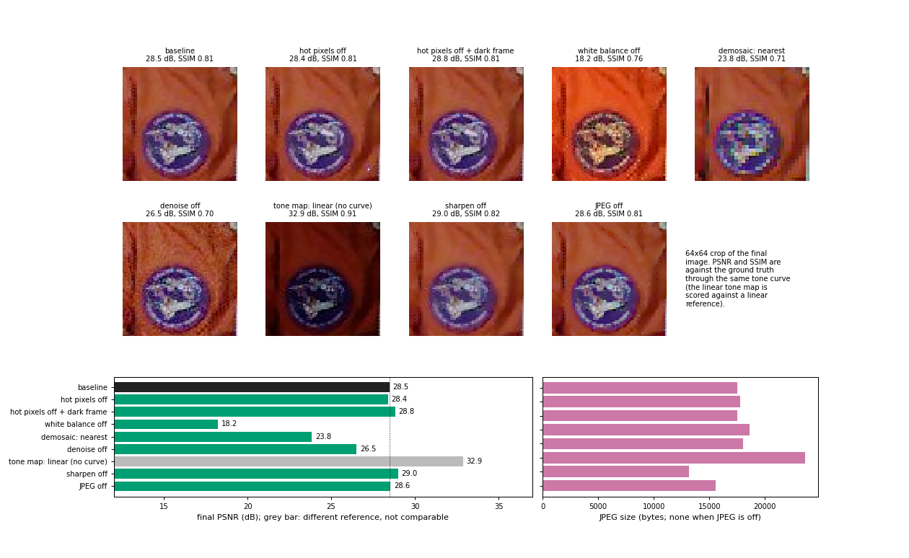
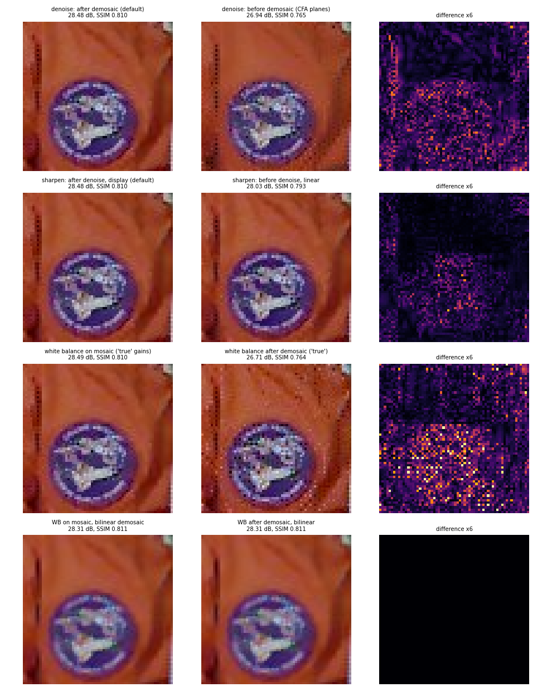
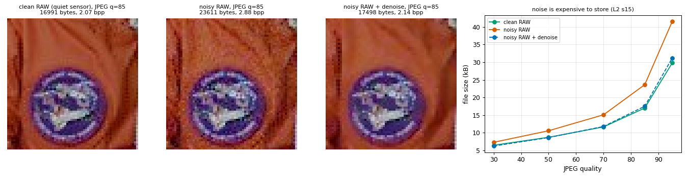
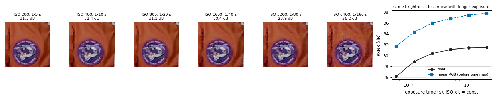
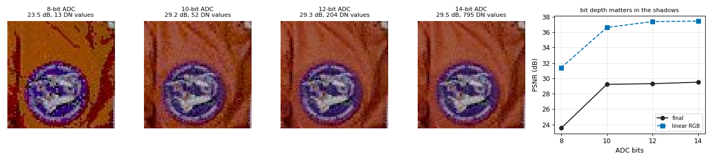

# 08 - Pipeline experiments

## 1. In one paragraph
The slide of the camera pixel pipeline says that *the processing order may vary* (L2 s3). This document puts that to the test on the default camera of [00_camera_pipeline.md](00_camera_pipeline.md): what happens when each processing stage is switched off, when two stages swap places, when the RAW is noisy or clean before it is stored (L2 s15), when the same brightness is reached with ISO or with exposure time (L2 s39), and when the ADC has fewer bits. All numbers come from `python scripts/make_figures_pipeline.py`.

## 2. Setup
Scene `astronaut`, 256 x 256 (`scenes.load`), default pipeline (tungsten 3200 K, DSLR sensor, 1/80 s, ISO 3200, 14 bit, white patch, median demosaic, bilateral denoise, unsharp `lam=0.5`, JPEG q=85), seeds fixed. PSNR and SSIM are those of the *last stage that ran* against the ground truth through the same tone curve (see the metrics section of doc 00). Crops are 64 x 64 pixels of the final image (the mission patch on the orange suit), shown with nearest-neighbour. One image and one noise realisation: differences below a few tenths of a dB should not be over-read.

## 3. Algorithm
Every experiment is `simulate(...)` with overrides (`stage={'param': v}`, `enabled={'stage': False}`), or a copy of `default_pipeline()` with `.move(...)`. Nothing else is changed between the two sides of a comparison. Where a stage must be replaced rather than removed (the tone curve and the demosaicer are needed by what follows), it is replaced by the simplest alternative: `tonemap='linear'` (clip only, no curve) and `demosaic='nearest'`.

## 4. Implementation notes
* `black_level` cannot be switched off: with `enabled={'black_level': False}` the next stage raises `ValueError: stage 'white_balance' needs data in domain linear or scene, got 'dn'`. RAW numbers carry an offset and a gain that every later stage assumes are gone.
* The linear tone map is scored against a linear reference (`StageMetrics` runs the reference through the same tone-mapping stage), so its PSNR is not comparable with the other bars; it is shown for the image, and the size of the file.
* The ISO and bit-depth experiments switch off the hot pixels (`hot_pixel_fraction=0` and the stage off) so that only the noise physics is compared. The quiet sensor of the JPEG experiment has `full_well=1e7`, `flux_at_white=1e9`, no read noise or defects and ISO 100: 14-bit quantisation and demosaicing are all that is left.

## 5. Experiments

### 5.1 Every processing stage switched off in turn


| variant | final PSNR (dB) | SSIM | JPEG bytes |
|---|---|---|---|
| baseline (default) | 28.48 | 0.810 | 17 498 |
| hot pixels off | 28.39 | 0.805 | 17 785 |
| hot pixels off + dark-frame subtraction | 28.82 | 0.810 | 17 495 |
| white balance off | 18.23 | 0.760 | 18 632 |
| demosaic: nearest | 23.84 | 0.709 | 18 023 |
| denoise off | 26.51 | 0.702 | 23 611 |
| tone map: linear (no curve; different reference) | 32.88 | 0.912 | 13 193 |
| sharpen off | 29.01 | 0.819 | 15 584 |
| JPEG off | 28.55 | 0.812 | none |

* **White balance** is the biggest single item: 10.3 dB. Without it the picture keeps the orange cast of the tungsten lamp (the illuminant estimate of the 'none' method is 29 degrees off).
* **Demosaicing** with nearest neighbour costs 4.6 dB and the pattern is visible in the crop; the choice of method is worth up to a few dB (bilinear, Malvar, median: 31.79, 32.85, 33.08 dB at the linear RGB stage).
* **Denoise** is worth 2.0 dB and 0.108 of SSIM, and it makes the file 35 % smaller: removing the noise removes the bits that JPEG would have spent on it (5.3).
* **Sharpen** is the one stage that *lowers* the numbers (PSNR 28.48 with it, 29.01 without; SSIM 0.810 against 0.819) and makes the file 12 % bigger. It is a perceptual trade: the crop is crisper, the error against the ground truth is slightly larger because the remaining noise is amplified too.
* **JPEG** costs 0.07 dB at q=85.
* **Hot pixels.** The median filter is almost neutral on PSNR (-0.09 dB without it): it removes the 31 defects but also replaces real detail. Subtracting a master dark frame instead removes them without false positives: +0.34 dB over the baseline (+0.43 dB over "off"). The detector sweep below shows why. `black_level` itself cannot be skipped (section 4).

Hot-pixel threshold sweep (the 31 hot pixels of the sensor are known; `black_level` output vs the noise-free oracle is 34.87 dB for the astronaut and 35.23 dB for the smoother `chelsea`):

| scene | threshold | pixels replaced | true defects caught | PSNR vs noise-free after the stage (dB) |
|---|---|---|---|---|
| astronaut | automatic (8 x MAD) | 830 | 31 | 30.63 |
| astronaut | 0.2 | 358 | 31 | 31.52 |
| astronaut | 0.3 (default) | 144 | 28 | 32.83 |
| astronaut | 0.4 | 71 | 26 | 33.96 |
| chelsea | automatic | 129 | 31 | 37.09 |
| chelsea | 0.2 | 40 | 31 | 37.73 |
| chelsea | 0.3 | 31 | 31 | 37.90 |

On a smooth photograph a single-frame detector removes the defects and improves PSNR by 2.7 dB; on a photograph with pixel-level detail it confuses detail with defects, and a lower threshold catches more defects but replaces ever more good pixels. This is a property of the one-sided median test, not of the implementation: a calibration (the dark frame) does not have the problem.

### 5.2 Order of the stages


| comparison | PSNR (dB) | SSIM | JPEG bytes | mean abs difference of the two final images |
|---|---|---|---|---|
| denoise after demosaic (default) | 28.48 | 0.810 | 17 498 | |
| denoise before demosaic (each CFA plane on its own) | 26.94 | 0.765 | 16 555 | 4.65 / 255 |
| sharpen after denoise, on display data (default) | 28.48 | 0.810 | 17 498 | |
| sharpen before denoise, on linear data | 28.03 | 0.793 | 17 787 | 2.82 / 255 |
| white balance on the mosaic, 'true' gains, median demosaic | 28.49 | 0.810 | 17 553 | |
| white balance after demosaic, 'true' gains, median demosaic | 26.71 | 0.764 | 20 271 | 5.21 / 255 |
| white balance on the mosaic, bilinear demosaic | 28.31 | 0.811 | 14 614 | |
| white balance after demosaic, bilinear | 28.31 | 0.811 | 14 614 | 0.00 / 255 |

* **Denoise before demosaic** is 1.5 dB worse. Each of the four site planes is a quarter of the pixels (the red plane has no green neighbours to help), the filter has to work on noise that the demosaicer has not yet combined, and noise is then spread by the interpolation. The image is smoother (the file is 5 % smaller) but lower in SSIM. The order that works better in the default camera is the one most cameras use, and it is also the cheapest: three planes instead of four.
* **Sharpen before denoise** (both on linear data) loses 0.45 dB: the denoiser smooths what the sharpener has just added, and the sharpener amplifies noise that the denoiser then has to remove. The default sharpens last, on display data.
* **White balance before or after demosaicing.** With a linear interpolator (bilinear) the two orders give *exactly* the same image: demosaicing interpolates each colour plane on its own, which commutes with multiplying that plane by a constant (the difference is 0.00 and the PSNR is identical). With the two demosaicers that look across channels, Freeman's median and Malvar (which work on colour differences such as R-G), the order matters: balancing after demosaicing loses 1.8 dB and the file is 15 % bigger (probably because more colour noise is left). The default does the white balance on the mosaic, so those methods see balanced channels. We verified the exact equality for bilinear and measured the loss for the median demosaicer; we did not isolate the mechanism further.
* The estimated gains also differ a little between the orders: white patch finds `[0.536, 1, 2.82]` from the binned mosaic and `[0.561, 1, 2.55]` from the demosaiced image.

### 5.3 Noisy RAW into JPEG (L2 s15)


L2 s15 shows a phone photograph at dusk: the 8 x 8 blocks are JPEG, and the sinusoidal patterns inside them are its attempt to compress noisy pixels. Here the same effect is measured. All three variants have the denoiser off except the last one.

| JPEG quality | clean RAW (bytes) | noisy RAW (bytes) | noisy + denoise (bytes) | noisy / clean | PSNR clean / noisy / denoised (dB) |
|---|---|---|---|---|---|
| 30 | 6 444 | 7 277 | 6 215 | 1.13 | 29.3 / 27.0 / 27.6 |
| 50 | 8 696 | 10 552 | 8 621 | 1.21 | 30.2 / 27.1 / 28.0 |
| 70 | 11 642 | 15 074 | 11 759 | 1.29 | 30.7 / 26.8 / 28.2 |
| 85 | 16 991 | 23 611 | 17 498 | 1.39 | 31.2 / 26.5 / 28.5 |
| 95 | 29 778 | 41 536 | 31 161 | 1.39 | 31.8 / 26.6 / 28.7 |

At the same quality setting the noisy capture needs up to 39 % more bytes than the clean one, because noise adds energy at every DCT frequency and the quantiser keeps it as long as the quality is high. Denoising *before* storing brings the file back to within 3 % of the clean one (17 498 against 16 991 bytes at q=85), and with a better PSNR than the noisy file. (Higher quality settings do not help the noisy file, whose PSNR stays between 26.5 and 27.1 dB: the error is the noise already in the picture, not the compression.)

### 5.4 ISO or exposure time (L2 s39)


`ISO x t` is held constant, so the output brightness is the same (mean linear value 0.147 to 0.149); only the split between exposure time and gain changes. Hot pixels are off. Scene white (green) collects `flux x QE x t = 1e5 x 0.4 x t` electrons.

| ISO | exposure | electrons at white | final PSNR (dB) | SSIM | linear RGB PSNR (dB) |
|---|---|---|---|---|---|
| 200 | 1/5 s | 8 000 | 31.48 | 0.927 | 37.76 |
| 400 | 1/10 s | 4 000 | 31.41 | 0.912 | 37.48 |
| 800 | 1/20 s | 2 000 | 31.12 | 0.889 | 36.84 |
| 1600 | 1/40 s | 1 000 | 30.41 | 0.856 | 35.97 |
| 3200 | 1/80 s | 500 | 28.92 | 0.813 | 34.37 |
| 6400 | 1/160 s | 250 | 26.16 | 0.724 | 31.72 |

Slide 39 says that raising ISO is equivalent to a longer exposure for brightness, that it improves SNR relative to brightening after the ADC, but that raising the exposure time improves SNR faster, so "maximise exposure time to the limits imposed by object motion, camera shake, or sensor saturation, then maximise ISO". The table is that rule: with the same brightness, every doubling of ISO halves the number of electrons and costs 0.1 to 2.8 dB (more at the high end, where read noise and shot noise of the few electrons both matter). Gain does not add light: it multiplies signal and noise together. (In the simulation the sensor never saturates at the long exposures, because the ISO is lowered with it; the clipped fraction of the RAW is 0.00 % at ISO 200 and 0.03 % at 6400.) What the simulation leaves out is motion blur: a 1/5 s shutter on a handheld camera is where the rule's first limit applies.

### 5.5 ADC bit depth in a dark scene


The scene is the astronaut at 4 % brightness, ISO 100 and 0.5 s, so the RAW signal fills only the first few percent of the range, and the result is brightened by a digital gain of 16 in `black_level`. Hot pixels and denoising are off.

| ADC | distinct DN values in the image | linear RGB PSNR (dB) | final PSNR (dB) | SSIM | JPEG bytes |
|---|---|---|---|---|---|
| 8 bit | 13 | 31.40 | 23.54 | 0.683 | 22 927 |
| 10 bit | 52 | 36.61 | 29.23 | 0.834 | 20 065 |
| 12 bit | 204 | 37.38 | 29.31 | 0.777 | 20 503 |
| 14 bit | 795 | 37.44 | 29.50 | 0.783 | 20 163 |

With 8 bits the whole image is described by 13 levels: after the gain of 16 the picture is posterised in the shadows (visible as flat steps in the crop) and the final PSNR is 5.7 to 6.0 dB below the others. From 10 bits on the quantisation step is smaller than the noise: the gain from 10 to 14 bits is 0.3 dB, because the shot noise of the few collected electrons has become the limit. Bit depth matters only while quantisation noise is comparable to the sensor noise, which is why a dark scene with a high digital gain is where a camera needs 12 or 14 bits. (SSIM is not monotonic between 10 and 14 bits: 0.834, 0.777, 0.783; with one noise realisation and noise this close to the signal in the shadows we would not read anything into it.)

## 6. Try it
```python
from isp import pipeline as P

# one ablation
base = P.simulate('astronaut')
no_wb = P.simulate('astronaut', white_balance={'method': 'none'})
print(base.final.metrics['psnr'], no_wb.final.metrics['psnr'])

# one reordering
pl = P.default_pipeline(white_balance={'method': 'true'}).move('white_balance', after='demosaic')
late = P.simulate('astronaut', pipeline=pl)
print(late['white_balance'].image.shape)     # (256, 256, 3): RGB gains now

# same brightness, different ISO / exposure split
for iso, t in [(200, 0.2), (6400, 0.00625)]:
    r = P.simulate('astronaut', adc={'iso': iso}, exposure={'exposure': t})
    print(iso, round(r.final.metrics['psnr'], 1), round(r['demosaic'].image.mean(), 3))
```

## 7. Limitations and extensions
* One scene and one noise seed per variant. The differences of a few tenths of a dB (hot pixels, 10 vs 14 bits) are within what a different seed would give; the large ones (white balance, demosaicing, denoise, ISO) are not. Average over seeds and scenes before drawing conclusions from small gaps.
* PSNR and SSIM against a ground truth penalise sharpening, local tone mapping and every other step that is meant to look better rather than to be accurate.
* Tone map and demosaic cannot simply be removed, so they are replaced by their simplest member. The processing order is explored only for three swaps; the pipeline allows any order that the domain rules accept (doc 00, section 4).
* Extensions: the order of `hot_pixels` and `white_balance`; denoising in a variance-stabilised domain; luma / chroma denoising before and after tone mapping; JPEG quality chosen so that two variants have equal bytes rather than equal quality; a sweep over all six scenes of `scenes.NAMES`.

## 8. References
* Levoy, M. *Digital Photography* course slides: L2 s3 (camera pixel pipeline, the processing order may vary), s15 (JPEG blocks and noise), s39 (ISO).
* Healey, G. E., Kondepudy, R. "Radiometric CCD camera calibration and noise estimation." *IEEE TPAMI* 16(3), 1994.
* Wallace, G. K. "The JPEG still picture compression standard." *IEEE Trans. Consumer Electronics* 38(1), 1992.
